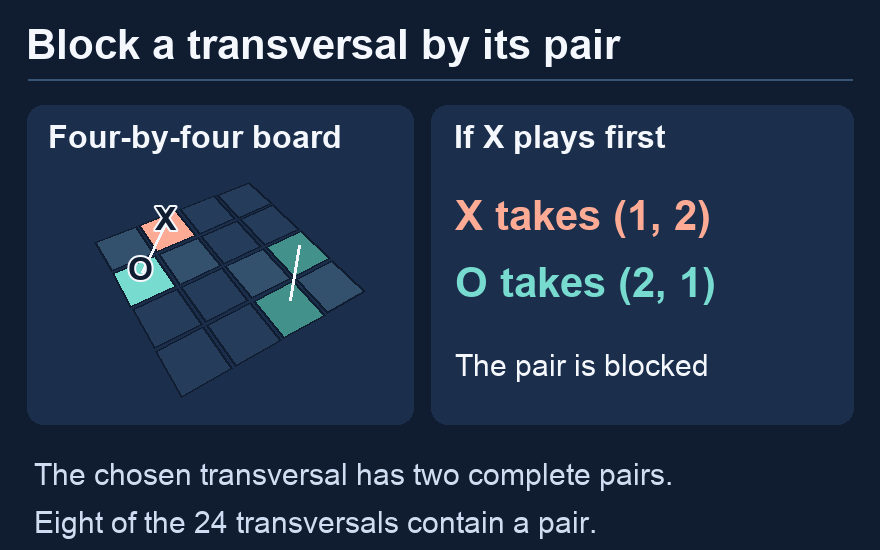

# A positive-density pairing defense in the transversal game

   

A disjoint pairing defense blocks a family of transversals of limiting density 1−exp(−1/2), refuting the conjectured vanishing winning threshold. The construction is asymptotically sharp among fixed disjoint-pair certificates.

[Read the paper](paper/manuscript.pdf) · [LaTeX source](paper/manuscript.tex) · [Original conjecture](https://dmtcs.episciences.org/en/articles/19063/download#page=13) · [Version DOI](https://doi.org/10.5281/zenodo.24572927)

## Explore the proof in 3D

Select the transversal with columns (2, 1, 4, 3). It contains two complete pairs. If X claims (1, 2), O claims (2, 1), immediately blocking that transversal. Eight of the 24 transversals on this board belong to the worked family.

[Download the offline explorer](https://raw.githubusercontent.com/DannyExperiments/transversal-game-positive-density/v1.0.0/visualization/paired-grid-explorer.zip) · [Explorer source](visualization/index.html) · [Worked example](proof/worked-pairing.md) · [GIF rendering source](visualization/render.py)

## Why the proof works

Each 2×2 block supplies two disjoint pairs. No first-player mark can complete a pair when the second player answers in its mate. Counting feasible subsets of pairs gives exact inclusion–exclusion coefficients and the density limit. Any disjoint cell pairing also has only a small proportion of incompatible ordered pair tuples for fixed tuple size, which gives the sharp limiting density for this class of certificates.

The separate [companion deduction](proof/companion-q1154.md) uses the published Maker–Breaker block strategy with one common opening cell. It gives an exponential bound for the smallest winning family. [Primary-source comparison](audits/public_safe_reports/LITERATURE.md)

## Reproduce the checks

    python3 -I scripts/verify_repository.py
    python3 -I verification/src/replay.py

[Recorded replay](verification/results/replay.txt) · [Scope](CLAIM_SCOPE_AND_LIMITATIONS.md) · [Reproducibility](REPRODUCIBILITY.md) · [Research disclosure](AI_DISCLOSURE.md)

## Cite

DannyExperiments. *A positive-density pairing defense in the transversal game*. Version 1.0.0, 27 November 2026. [Version DOI](https://doi.org/10.5281/zenodo.24572927).
